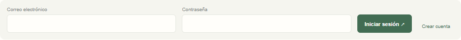
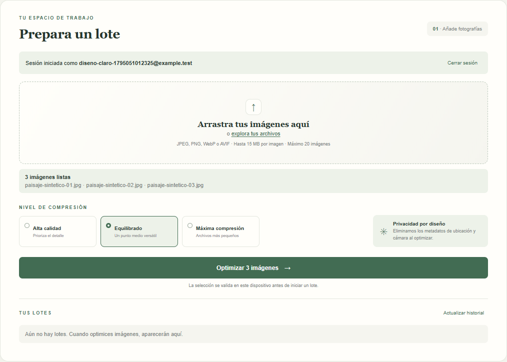
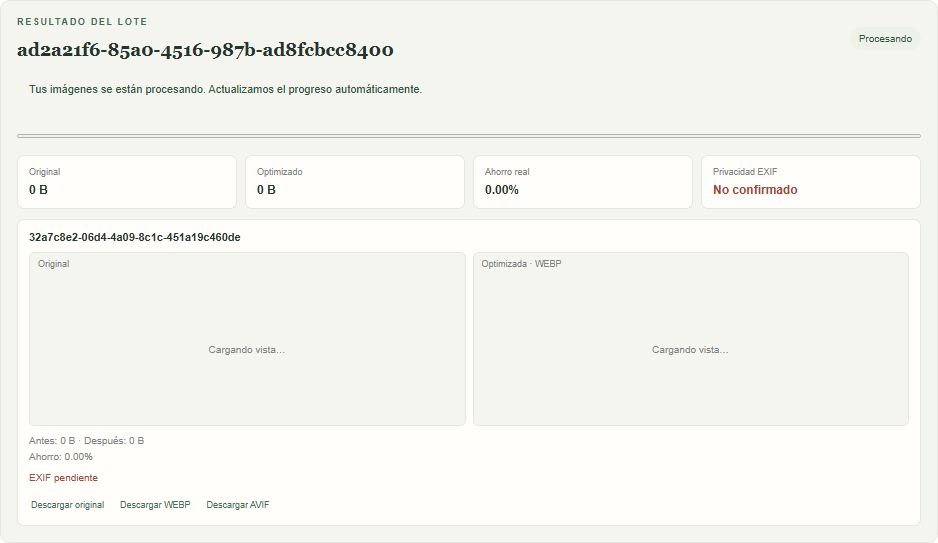
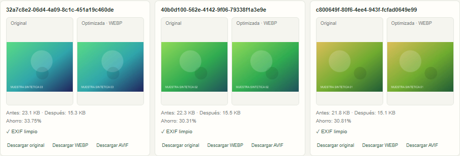
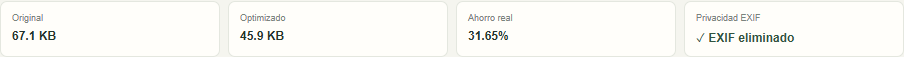
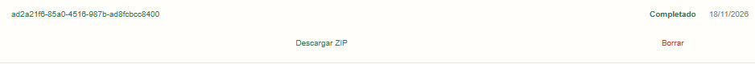
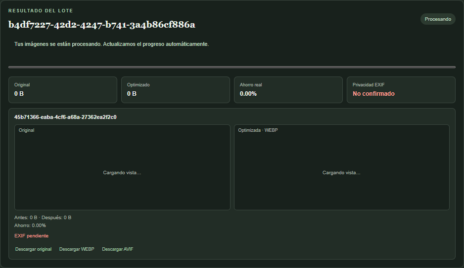
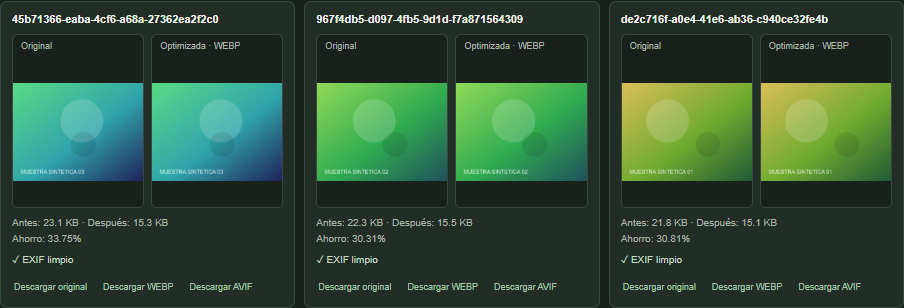
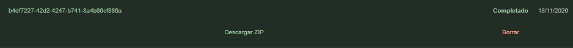
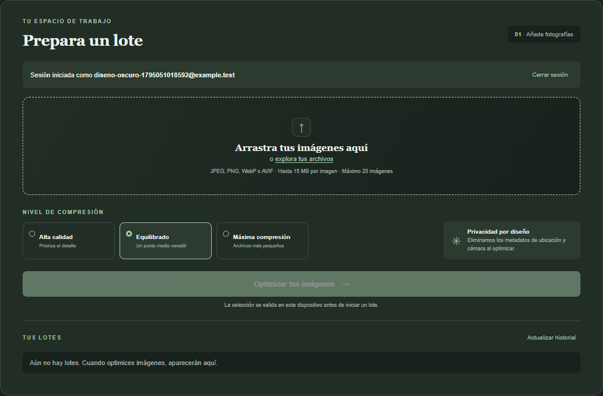

[](https://github.com/linochamorro/mediashrink-cloud/actions/workflows/ci.yml)
[](https://react.dev/)
[](https://www.typescriptlang.org/)
[](https://aws.amazon.com/dynamodb/)
[](LICENSE)

# MediaShrink Cloud — Estudio de imagen privado

MediaShrink Cloud optimiza lotes de fotografías privadas: convierte cada imagen a WebP y AVIF, genera miniaturas y elimina metadatos EXIF/GPS antes de mostrar métricas reales de espacio ahorrado. La interfaz en español incluye tema Claro/Oscuro, comparativa antes/después, descarga individual o en ZIP y borrado manual, con autenticación propia y una infraestructura declarativa que se ejecuta por completo en local.

> **Alcance para portafolio:** esta demostración usa cuentas y datos ficticios generados por el seed local. La documentación describe el código y la configuración de este repositorio; no acredita despliegues ni servicios externos activos.

## Funcionalidades

- **Optimización por lotes:** hasta 20 imágenes JPEG, PNG, WebP o AVIF por lote, con tres niveles de compresión (alta calidad, equilibrado y máxima compresión) y validación en el dispositivo antes de subir.
- **Privacidad por diseño:** eliminación de todos los metadatos de cámara y ubicación, subida mediante URL firmada, aislamiento de datos por usuario y borrado manual del lote y sus archivos.
- **Comparativa y métricas:** vista antes/después dentro de la ventana de retención, con tamaño original, tamaño optimizado, porcentaje de ahorro real y confirmación de EXIF eliminado.
- **Descargas y ciclo de vida:** descarga individual de cada variante y descarga del lote completo en ZIP con optimizadas y miniaturas; retención de 30 días y cola con reintentos y DLQ.
- **Interfaz:** SPA en español con tema Claro/Oscuro, zona de arrastre y suelta, progreso con sondeo automático e historial de lotes.

La vista general del sistema está documentada en [docs/architecture/00-overview.md](docs/architecture/00-overview.md).

## Tecnología y estructura

Vite + React + TypeScript · Hono + Zod + JWT propio · `sharp` (libvips) · DynamoDB, S3 y SQS/DLQ aprovisionados con Terraform · Vitest y Playwright sobre `aws/aws-emulator`.

| Ruta | Contenido |
|---|---|
| `frontend/src/` | SPA React: autenticación, carga drag & drop, presets, sondeo, comparativa y métricas |
| `backend/src/` | API Hono, contratos Zod, worker `sharp` y servidor local con consumidor SQS |
| `infra/terraform/` | Buckets S3 `raw` y `optimized`, SQS + DLQ, DynamoDB, CORS y ciclo de vida |
| `tools/scripts/seed/` | Datos demo sintéticos e idempotentes para el emulador local |
| `tests/unit/` | Pruebas unitarias aisladas (reglas, contratos y configuración) |
| `tests/integration/` | Pruebas de integración S3/SQS/DynamoDB contra el emulador |
| `tests/e2e/` | Pruebas de extremo a extremo y capturas reales con Playwright |
| `docs/architecture/`, `docs/decisions/` | Documentación técnica y decisiones arquitectónicas |
| `docs/images/` | Capturas de la interfaz del producto |

## Inicio local

Requisitos: Node.js 26, npm 11, Docker con motor Linux y Terraform 1.17 para el emulador local (sin cuenta AWS).

```bash
git clone https://github.com/linochamorro/mediashrink-cloud.git
cd mediashrink-cloud
npm ci
cp .env.example .env
# Ajusta en .env los marcadores locales (JWT, endpoint y rutas del emulador).
mkdir -p .local/aws-emulator
docker compose up -d
# Con el contenedor healthy, exporta los archivos efímeros que genera el emulador:
docker cp mediashrink-aws-emulator:/home/emulator/.aws/emulator/9297/ca.pem ./.local/aws-emulator/ca.pem
docker cp mediashrink-aws-emulator:/home/emulator/.aws/emulator/9297/config ./.local/aws-emulator/config
docker cp mediashrink-aws-emulator:/home/emulator/.aws/emulator/9297/emulator_credentials ./.local/aws-emulator/emulator_credentials
terraform -chdir=infra/terraform init -input=false
terraform -chdir=infra/terraform apply -input=false -var=is_emulator=true
npm run seed
npm run dev:backend
npm run dev:frontend
```

La API y el worker quedan en `http://localhost:3001` y la SPA en `http://localhost:5173`. Las credenciales del emulador son efímeras y se renuevan en cada arranque: repite el bloque de `docker cp` tras cada inicio. Para servir el backend sin recarga está disponible `npm start --workspace=@mediashrink/backend`. El seed solo opera sobre el emulador local y es idempotente; apaga el contenedor con `docker compose down` cuando termines.

## Comandos del proyecto

| Comando | Uso |
|---|---|
| `npm ci` | Instalación reproducible desde `package-lock.json` |
| `npm run dev:frontend` | Servidor de desarrollo de la SPA (Vite) |
| `npm run dev:backend` | API y worker en modo desarrollo |
| `npm run build` | Compilación de producción de frontend y backend |
| `npm run typecheck` | Comprobación estática de tipos |
| `npm run lint` | Análisis estático (ESLint) |
| `npm run test:unit` | Pruebas unitarias aisladas sin BD ni `.env` |
| `npm run seed` | Seed sintético idempotente contra el emulador local |
| `npx vitest run tests/integration` | Pruebas de integración (requiere emulador y Terraform aplicado) |
| `npx playwright test --config=tests/e2e/playwright.real.config.ts` | Flujo de extremo a extremo real (requiere emulador, Terraform y backend) |

El workflow de CI en `.github/workflows/ci.yml` ejecuta, sobre Node.js 26: checkout, instalación con `npm ci --no-audit --no-fund`, `npm run typecheck`, `npm run lint` y `npm run test:unit` (303 pruebas unitarias aisladas en 32 archivos).

## Imágenes

### Portada y acceso




### Preparación del lote




### Resultado y privacidad







<details>
<summary>Otras vistas</summary>









</details>

## Documentación

- [Arquitectura del sistema](docs/architecture/00-overview.md)
- [Índice de decisiones técnicas (ADR)](docs/decisions/index.md)

## Licencia

Licencia MIT; consulta [LICENSE](LICENSE).
