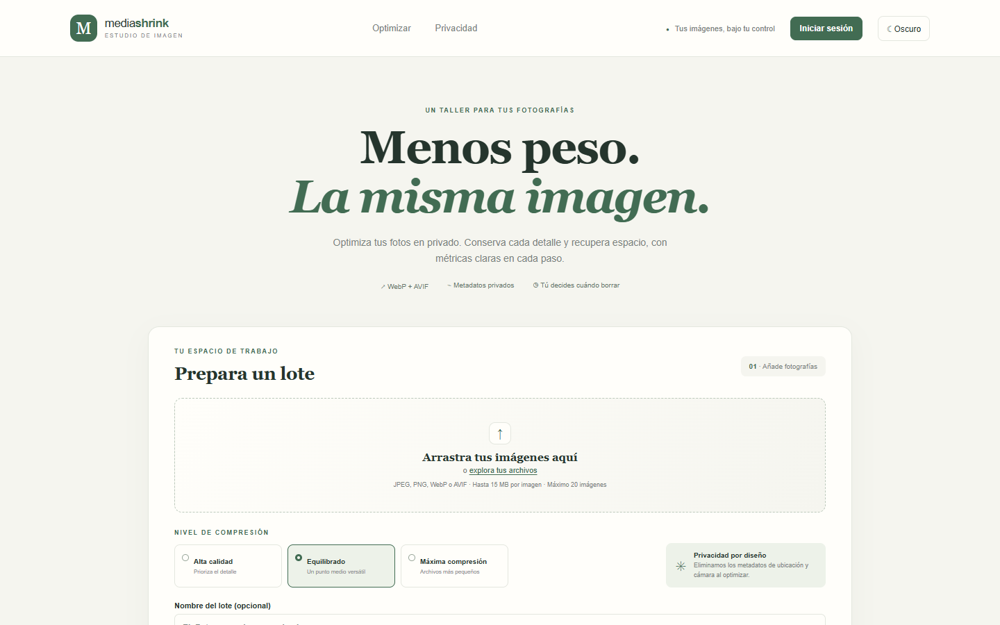
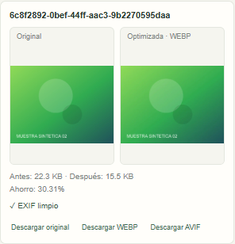
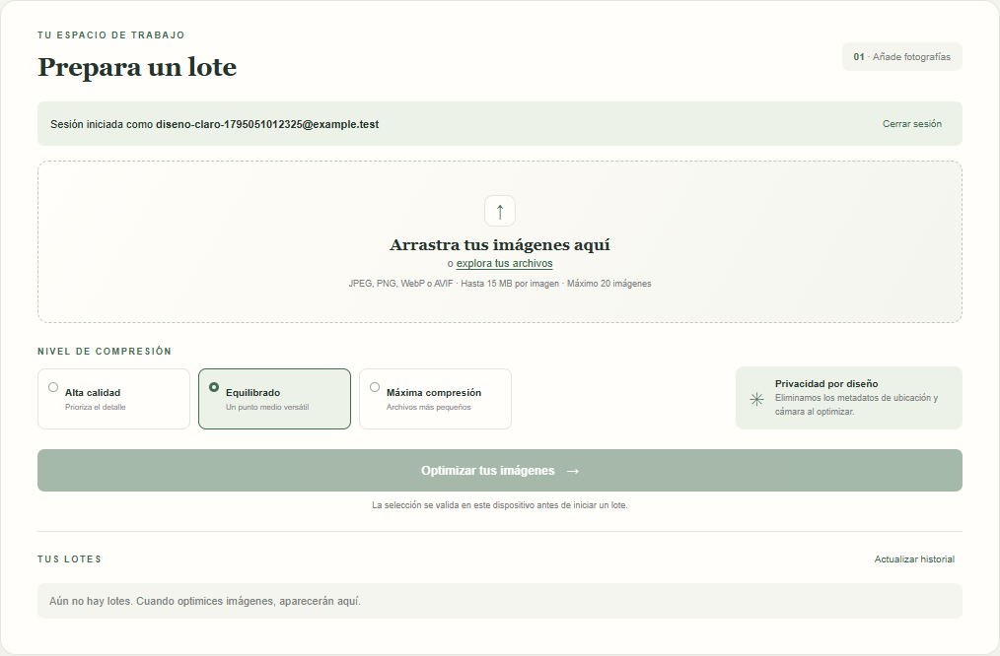
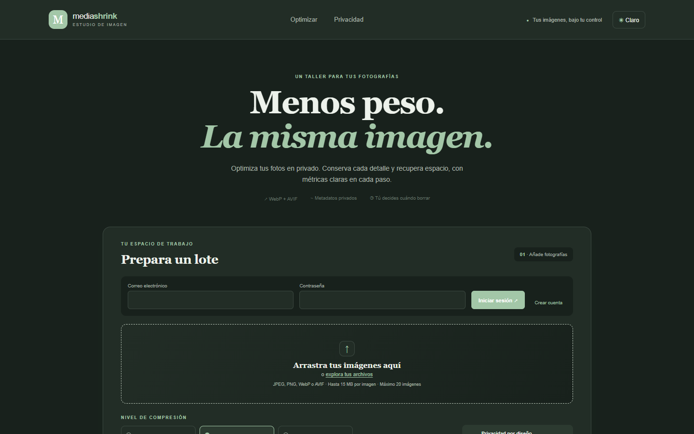
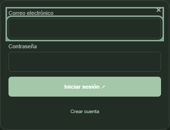
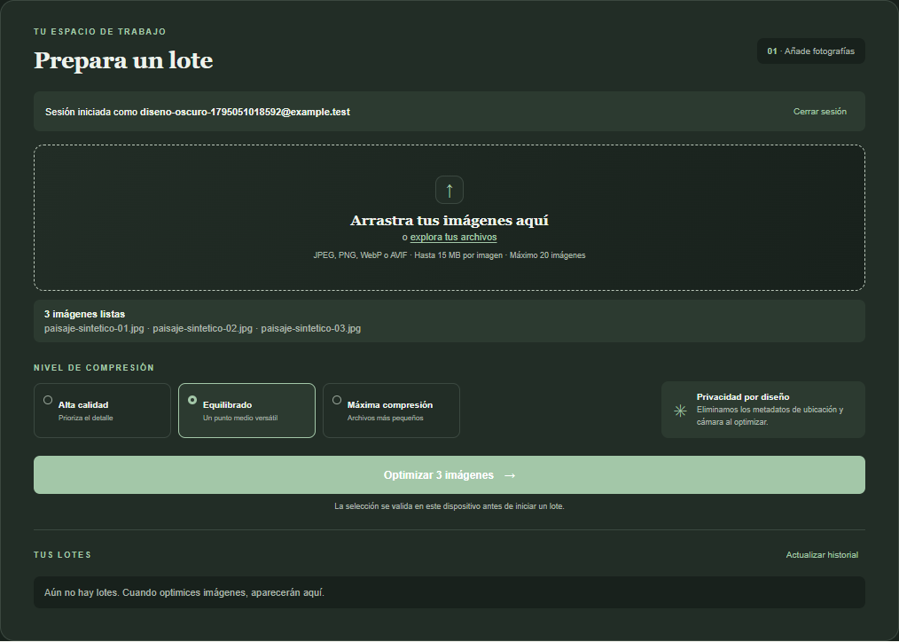
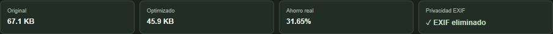
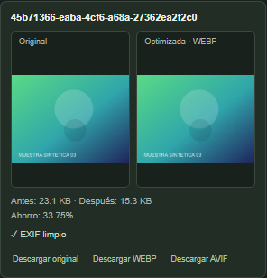

[](https://github.com/linochamorro/mediashrink-cloud/actions/workflows/ci.yml)
[](https://github.com/linochamorro/mediashrink-cloud/actions/workflows/infra-integration.yml)
[](https://aws.amazon.com/)
[](https://www.terraform.io/)
[](https://github.com/aws/aws-emulator)
[](https://react.dev/)
[](https://www.typescriptlang.org/)
[](docs/sdd/spec.md)
[](LICENSE)

# MediaShrink Cloud — Estudio de imagen privado

MediaShrink Cloud es una aplicación web **AWS serverless + Terraform (IaC)** desarrollada mediante **ingeniería orquestada con agentes de IA (SDD + TDD)** con trazabilidad pública completa desde la Fase 0. Optimiza lotes de fotografías privadas: convierte cada imagen a **WebP** y **AVIF**, genera miniaturas y elimina todos los metadatos **EXIF/GPS** antes de calcular métricas reales de espacio ahorrado. La SPA en español incluye tema Claro/Oscuro, acceso y sesión integrados en el header, nombre personalizado de lote, historial con fecha y hora, comparativa antes/después, descarga individual o en ZIP y borrado manual.

Todo el stack cloud (**S3, SQS + DLQ y DynamoDB** con los SDKs oficiales de AWS y Terraform) se ejecuta íntegramente en local y en GitHub Actions a **coste $0** mediante el emulador oficial de AWS ([`aws/aws-emulator`](https://github.com/aws/aws-emulator)) en Docker.

> **Alcance para portafolio:** esta demostración opera sobre el emulador oficial de AWS en local con cuentas y datos ficticios generados por el seed. La arquitectura, los SDKs de AWS y la infraestructura Terraform son reales y reproducibles sin requerir cuenta ni gasto en AWS.

## Arquitectura AWS serverless e IaC (Terraform)

- **Infraestructura declarativa real ([`infra/terraform/`](infra/terraform/)):** aprovisiona **11 recursos de AWS** reproducibles:
  - **2 buckets S3 separados** (`raw` y `optimized`) para evitar bucles de eventos, con reglas **CORS** y política de ciclo de vida de **30 días**.
  - **Cola SQS principal + Dead-Letter Queue (DLQ)** con política de redirección (`maxReceiveCount = 3`) para aislar imágenes corruptas sin detener el resto del lote.
  - **Tabla DynamoDB** con particionado estricto por `userId` (aislamiento multi-usuario anti-IDOR) y **TTL automático de 30 días**.
- **SDKs oficiales de AWS JS v3 y patrones cloud-native:**
  - `@aws-sdk/client-s3` y `@aws-sdk/s3-request-presigner` para subidas y descargas mediante URLs firmadas.
  - `@aws-sdk/client-sqs` con **patrón *Claim Check***: cuando un lote de fotografías reales supera el umbral de 200 KiB (por debajo del límite estricto de 256 KiB de AWS SQS), el mensaje encola solo los metadatos y el worker lee el binario directamente desde S3 `raw`.
  - `@aws-sdk/client-dynamodb` / `lib-dynamodb` para persistencia transaccional y consultas por usuario.
  - **Hono** (estándar Web `Request`/`Response`) con adaptador portable entre servidor Node local y **AWS Lambda**, más **Vite + React** compilable como SPA estática para **S3 + CloudFront**.
- **Emulación local fiel a coste $0 (Docker):**
  - Se utiliza el emulador oficial de AWS en Rust ([**`aws/aws-emulator`**](https://github.com/aws/aws-emulator)), ejecutado mediante la imagen OCI multi-arquitectura fijada por digest SHA-256 ([`ghcr.io/xsavikx/aws-emulator`](https://github.com/xsavikx/aws-emulator)) definida en [`docker-compose.yml`](docker-compose.yml) con límites de recursos (`2 GiB RAM / 2.0 CPUs`) y credenciales/CA efímeros por arranque.
  - Con `-var=is_emulator=true`, Terraform aprovisiona sobre el emulador local; con `-var=is_emulator=false` y credenciales reales, **la misma infraestructura despliega en AWS real sin modificar el código de producto**.

## Ingeniería dirigida por IA y orquestación multi-agente (SDD + TDD)

A diferencia de repositorios donde el uso de IA queda oculto, este proyecto publica abiertamente toda su arquitectura de gobierno, especificación y verificación con agentes de IA desde el inicio:

- **Orquestación multi-rol con separación de deberes ([`.agents/roles/`](.agents/roles/), [`AGENTS.md`](AGENTS.md)):** flujo dirigido con aprobación humana en decisiones materiales y gates, delegando la ejecución en 5 roles especializados con fronteras estrictas:
  - **Architect:** coordina cada fase autorizada, audita entregables y orquesta ciclos correctivos.
  - **Developer y Designer:** implementan lógica y UI siguiendo ciclo **SDD + TDD** (`RED → GREEN → REFACTOR`).
  - **Tester independiente:** ejecuta suites unitarias, integración real contra emulador y E2E human-like en Playwright CLI sin modificar código de producto (`PASSED` / `NO-PASSED`).
  - **Auditor de seguridad:** realiza revisiones estáticas independientes (secretos, CORS/SSRF, anti-enumeración, aislamiento anti-IDOR, contratos e higiene de rutas).
- **Spec-Driven Development ([`docs/sdd/`](docs/sdd/)):** constitución técnica, especificación funcional, plan arquitectónico, contratos Zod congelados (`v1.1.0`) y paquetes por fase (`P-00` a `P-05`) antes de escribir código.
- **Trazabilidad y evidencia pública ([`STATE.md`](STATE.md), [`reports/`](reports/)):** historial completo de levantamiento (`reports/intake/`), reportes por fase y evidencias (`reports/implementation/`), auditorías (`reports/audits/`) y verificaciones finales (`reports/verification/`).

## Funcionalidades

- **Optimización por lotes:** hasta 20 imágenes JPEG, PNG, WebP o AVIF por lote (hasta 15 MB por imagen), con **nombre opcional del lote**, tres niveles de compresión (alta calidad, equilibrado y máxima compresión) y validación en el dispositivo antes de subir.
- **Privacidad por diseño:** eliminación verificada de metadatos de cámara y ubicación GPS (`sharp`/libvips), subida mediante URL firmada, aislamiento estricto de datos por usuario, rate limiting independiente (`/auth` 5 req/min anti-fuerza-bruta vs. API autenticada 120 req/min) y borrado manual completo de DynamoDB y S3.
- **Comparativa y métricas reales:** vista antes/después dentro de la ventana de retención, con tamaño original confirmado por `HeadObject`, tamaño optimizado, porcentaje de ahorro real y badge `✓ EXIF eliminado`.
- **Descargas y resiliencia:** descarga individual (Original, WebP, AVIF) y descarga del lote completo en ZIP con optimizadas y miniaturas; reintentos automáticos y DLQ para archivos dañados (`Completado parcialmente` / `Fallido`).
- **Interfaz:** SPA en español con tema Claro/Oscuro persistente, **acceso y sesión en el header** junto al selector de tema, zona de arrastre y suelta, sondeo automático e **historial ordenado con nombre, fecha y hora**.

La vista general del sistema está documentada en [docs/architecture/00-overview.md](docs/architecture/00-overview.md) y las decisiones técnicas en [docs/decisions/ADR-001-stack-and-aws-emulator.md](docs/decisions/ADR-001-stack-and-aws-emulator.md).

## Tecnología y estructura

Vite + React + TypeScript · Hono + Zod + JWT propio · `sharp` (libvips) · AWS SDK JS v3 (S3, SQS/DLQ, DynamoDB) · Terraform (IaC) · Docker ([`aws/aws-emulator`](https://github.com/aws/aws-emulator)) · Vitest y Playwright CLI.

| Ruta | Contenido |
|---|---|
| `frontend/src/` | SPA React: acceso/sesión en header, carga drag & drop, nombre de lote, presets, sondeo, comparativa y métricas |
| `backend/src/` | API Hono, contratos Zod `v1.1.0`, worker `sharp`, Claim Check SQS/S3 y servidor local |
| `infra/terraform/` | Infraestructura AWS (11 recursos): buckets S3 `raw`/`optimized`, SQS + DLQ, DynamoDB, CORS y ciclo de vida 30 d |
| `tools/scripts/seed/` | Datos demo sintéticos e idempotentes para el emulador local |
| `tests/unit/` | 355 pruebas unitarias aisladas en 37 archivos (reglas, contratos, seguridad, Claim Check y UI) |
| `tests/integration/` | Pruebas de integración reales S3/SQS/DynamoDB contra `aws/aws-emulator` (incluyendo lotes > 400 KiB) |
| `tests/e2e/` | Pruebas E2E reales con Playwright CLI (31/31 escenarios human-like sin mocks ni muletas) y capturas |
| `docs/architecture/`, `docs/decisions/` | Documentación técnica y decisiones arquitectónicas (ADR) |
| `docs/sdd/`, `reports/` | Especificación SDD, paquetes por fase (`P-00`–`P-05`), auditorías y evidencias de QA |
| `.agents/roles/`, `AGENTS.md`, `STATE.md` | Contratos de los 5 roles de agentes IA, reglas operativas y estado trazable |
| `docs/images/` | 18 capturas reales de la interfaz en Claro y Oscuro |

## Inicio local

Requisitos: Node.js 26, npm 11, Docker con motor Linux y Terraform 1.17 para el emulador local (`aws/aws-emulator`, **sin cuenta AWS**).

```bash
git clone https://github.com/linochamorro/mediashrink-cloud.git
cd mediashrink-cloud
npm ci
cp .env.example .env
# Ajusta en .env los marcadores locales (JWT, endpoint y rutas del emulador).
mkdir -p .local/aws-emulator
docker compose up -d
# Con el contenedor healthy, exporta los archivos efímeros que genera el emulador:
docker cp mediashrink-aws-emulator:/home/emulator/.aws/emulator/9297/ca.pem ./.local/aws-emulator/ca.pem
docker cp mediashrink-aws-emulator:/home/emulator/.aws/emulator/9297/config ./.local/aws-emulator/config
docker cp mediashrink-aws-emulator:/home/emulator/.aws/emulator/9297/emulator_credentials ./.local/aws-emulator/emulator_credentials
terraform -chdir=infra/terraform init -input=false
terraform -chdir=infra/terraform apply -input=false -var=is_emulator=true
npm run seed
npm run dev:backend
npm run dev:frontend
```

La API y el worker quedan en `http://localhost:3001` y la SPA en `http://localhost:5173`. Las credenciales del emulador son efímeras y se renuevan en cada arranque: repite el bloque de `docker cp` tras cada inicio. El seed solo opera sobre el emulador local y es idempotente; apaga el contenedor con `docker compose down` cuando termines.

## Comandos del proyecto

| Comando | Uso |
|---|---|
| `npm ci` | Instalación reproducible desde `package-lock.json` |
| `npm run dev:frontend` | Servidor de desarrollo de la SPA (Vite + proxy y relay local del emulador) |
| `npm run dev:backend` | API Hono y consumidor SQS en modo desarrollo (carga `.env` automáticamente) |
| `npm run build` | Compilación de producción de frontend y backend |
| `npm run typecheck` | Comprobación estática de tipos |
| `npm run lint` | Análisis estático (ESLint) |
| `npm run test:unit` | 355 pruebas unitarias aisladas sin BD ni `.env` |
| `npm run seed` | Seed sintético idempotente contra el emulador local |
| `npx vitest run tests/integration` | Pruebas de integración reales (requiere emulador y Terraform aplicado) |
| `npx playwright test --config=tests/e2e/playwright.real.config.ts` | Flujo de extremo a extremo real (requiere emulador, Terraform y backend) |

**Integración continua (GitHub Actions):**
- [`.github/workflows/ci.yml`](.github/workflows/ci.yml): ejecuta en Node.js 26 instalación reproducible (`npm ci`), `typecheck`, `lint` y `test:unit` (**355 pruebas unitarias en 37 archivos**).
- [`.github/workflows/infra-integration.yml`](.github/workflows/infra-integration.yml): levanta el emulador [`aws/aws-emulator`](https://github.com/aws/aws-emulator) en Docker, valida y aplica **Terraform** (`fmt`, `init`, `validate`, `apply`), ejecuta las **pruebas de integración reales** contra S3/SQS/DynamoDB y apaga el contenedor limpiamente.

## Imágenes

### Portada y acceso


### Preparación del lote


### Resultado y privacidad






<details>
<summary>Otras vistas</summary>










</details>

## Documentación

- [Arquitectura del sistema](docs/architecture/00-overview.md)
- [Índice de decisiones técnicas (ADR)](docs/decisions/index.md)
- [Especificación y plan SDD](docs/sdd/spec.md)
- [Contratos de agentes IA y estado operativo](AGENTS.md) · [STATE.md](STATE.md)
- [Flujo de desarrollo local y emulador AWS](docs/runbooks/development-workflow.md)

## Licencia

Licencia MIT; consulta [LICENSE](LICENSE).
